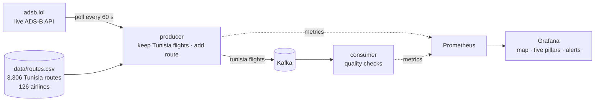

# Tunisia Flights Data Observability

Live tracking of every flight **to, from and within Tunisia** (Tunisair, Nouvelair, Transavia,
easyJet, TUI, Air France and 120+ other airlines), streamed through **Kafka** and
monitored with **Grafana** using the five pillars of data observability: **volume,
freshness, schema, distribution and lineage**.

All data is real: aircraft positions come from public ADS-B receivers through the free
[adsb.lol](https://adsb.lol) API, and routes come from open aviation datasets.



| Service | What it does |
|---|---|
| `producer` | Every 60 s, queries 10 areas (Tunisia, Libya & Malta, Algeria, Mediterranean, France, Benelux, UK, Germany, Poland). Keeps aircraft whose flight number is a known Tunisia route, plus every Tunisair / Nouvelair / Tunisair Express plane. Adds airline, direction and route (e.g. `Paris → Tunis`), then publishes one message per aircraft |
| `kafka` | Single-node Kafka 3.9 (KRaft) with the topic `tunisia.flights` |
| `consumer` | Validates every message and exposes the data-quality metrics and live flight positions |
| `prometheus` | Stores metrics; recording and alerting rules are in [`prometheus/`](prometheus/) |
| `grafana` | Provisioned **Tunisia Flights · Data Observability** dashboard with Notebooks enabled |
| `kafka-ui` | Browse the topic and read the messages |

## Quick start

Requirements: Docker with Compose v2, and an internet connection.

```bash
git clone https://github.com/<you>/tunisia-flights-data-observability.git
cd tunisia-flights-data-observability
docker compose up -d --build
```

| UI | URL |
|---|---|
| Grafana dashboard | http://localhost:3000 |
| Kafka UI | http://localhost:8080 |
| Prometheus | http://localhost:9090 |

The first flights show up on the map after about 1–2 minutes. Run `make help` for shortcuts
such as `make flights` (flights found in the latest polls) or `make topic` (read raw Kafka messages).

> Most Tunisia flights operate during the day, so expect few flights at night (Tunisia is UTC+1).

## The dashboard

- **How to read this dashboard:** a plain-language intro to the data and where it comes from.
- **Filters:** **Airline** and **Direction** (arrival / departure / domestic) dropdowns at the top,
  e.g. to show only Nouvelair arrivals.
- **Map:** every plane flying to or from Tunisia, pointing in its direction of travel and coloured by altitude.
- **Flights table:** flight, airline, direction, from → to, status (climbing / cruising / descending), aircraft,
  altitude, speed, distance left, **estimated arrival**, **tracked since**, **last update**.
- **Five rows, one per pillar:** each one answers a single question about the data.

ADS-B only carries position, not schedules. So *tracked since* is when the pipeline first
saw the flight, and *estimated arrival* is calculated from the straight-line distance and the
current speed.

## The data

A message on the `tunisia.flights` topic:

```json
{
  "hex": "02a1b0", "callsign": "LBT719", "airline_code": "LBT", "airline": "Nouvelair",
  "direction": "Arrival", "registration": "TS-INQ", "aircraft_type": "A320",
  "lat": 39.12, "lon": 9.29, "altitude_ft": 36025, "ground_speed_kt": 441.4, "track_deg": 143.8,
  "origin": "LFBD", "origin_city": "Bordeaux", "origin_country": "France",
  "destination": "DTTA", "destination_city": "Tunis", "destination_country": "Tunisia",
  "position_ts": 1793722012.4, "fetched_at": 1793722013.1,
  "source": "adsb.lol", "source_area": "Central Mediterranean", "raw_field_count": 47
}
```

| Data | Source | License |
|---|---|---|
| Live positions | [adsb.lol API](https://www.adsb.lol/docs/open-data/api/) (community ADS-B network) | [ODbL 1.0](https://opendatacommons.org/licenses/odbl/1-0/) |
| Flight number → route, airline names | [VRS standing data](https://github.com/vradarserver/standing-data) | CC0 |
| Airports (city, country) | [OurAirports](https://ourairports.com/data/) | Public domain |

**Polling rate:** the producer polls every 60 s, spreading its 10 requests evenly over the
minute (one every 6 s) and backing off when adsb.lol answers `429 Too Many Requests`. A cruising
airliner moves about 14 km per minute, which is plenty for a live map and for data-quality
checks, and stays gentle on a free community API. Don't go below about 15 s (`POLL_SECONDS`).

To refresh the routes, run `make routes` (it calls `scripts/build_routes.py`). To track
another country, change `TUNISIA = "DT"` in the script to its ICAO airport prefix (e.g. `GM` for
Morocco), and update `AREAS` in the producer.

## The five pillars

Real data is messy, so the checks catch real problems and nothing is simulated.

| Pillar | Question | What's measured | Alert |
|---|---|---|---|
| **Volume** | Is the expected amount of data arriving? | Active flights vs. the same time yesterday; aircraft returned by the API | `NoFlightsWhileExpected`, `SourceApiFailing` |
| **Freshness** | How old is the data when it lands? | Position age (aircraft broadcast → consumer), latency per pipeline stage, time since the last poll | `PipelineStalled`, `PositionsStale` |
| **Schema** | Has the structure changed? | Rejected messages by reason (`missing_position`, `bad_altitude`, …), ADS-B fields per record, unknown routes | `InvalidMessages`, `RouteReferenceDataOutdated` |
| **Distribution** | Do the values look normal? | Flights per airline, per connected country, arrivals vs. departures, aircraft models, altitude | — |
| **Lineage** | Where does the data come from, and does all of it arrive? | Counts at each stage (API → filter → Kafka → consumer → valid), API status per area | `MessagesLostInPipeline` |

Two real quirks this pipeline handles:

- **Missing fields:** ADS-B transponders report different sets of fields, so the field count per record varies.
- **Ground altitude:** `alt_baro` is the string `"ground"` instead of a number when an aircraft is on the ground.

Every alert has `pillar` and `team=data-engineering` labels, ready for notification routing.

## Showcase it with a Grafana Notebook

Grafana 13 Notebooks (enabled through the `dashboard.notebooks` feature toggle) combine
panels with written analysis, and export as PDF or Markdown.

1. In Grafana, open **Notebooks → New notebook**, titled e.g. *"Is our flight data healthy? Tunisian air traffic, one day"*.
2. Start with the **map panel** and one paragraph about the data source.
3. For each pillar, add a text block (the question it answers) and then the matching panel.
4. Write what you observed. For example: *"Between 01:00 and 05:00 there are no flights,
   which is expected: the volume alert compares with yesterday so it stays silent."*
5. Export as PDF, or share the link.

## Project layout

```
.
├── docker-compose.yml
├── Makefile
├── data/routes.csv              # flight number → route for every Tunisia flight
├── scripts/build_routes.py      # rebuilds routes.csv from public sources
├── scripts/build_dashboard.py   # generates the Grafana dashboard JSON
├── producer/producer.py         # adsb.lol → Kafka
├── consumer/consumer.py         # Kafka → quality checks → metrics
├── prometheus/                  # scrape config, recording rules, alerts
└── grafana/                     # data source, dashboard provisioning, dashboard JSON
```

## Ideas to extend it

- Store every position in a data lake (S3/MinIO + Parquet) for history and replay.
- Add a Schema Registry (Avro) between the producer and the consumer.
- Add the whole adsb.lol stream (every aircraft, ~1.4 million messages a day) as a second topic.

## Acknowledgements

Based on the article *Data Observability with Grafana: The Five Pillars in Practice* by
Imen Bakir. Flight data © adsb.lol contributors (ODbL).

## License

Code: [MIT](LICENSE). Data under `data/` is derived from CC0 and public-domain sources.
