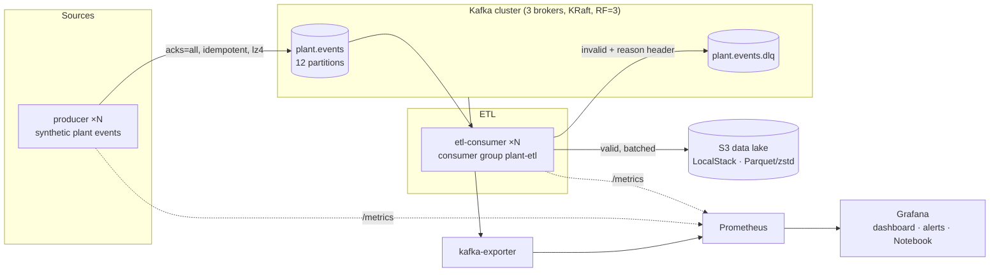

# Kafka Data Observability with Grafana

A production-style streaming pipeline (**Kafka → ETL → S3 data lake**) instrumented for the
five pillars of data observability: **volume, freshness, schema, distribution and lineage**.
It ships with a ready-made Grafana dashboard, Prometheus alerting rules, and a guide for
writing up your findings in a Grafana Notebook.

It's based on the article *Data Observability with Grafana: The Five Pillars in Practice*,
adapted from Loki to a Kafka-based, high-volume setup.

## Architecture



| Component | Role |
|---|---|
| `kafka1..3` | Apache Kafka 3.9, KRaft (no ZooKeeper), RF=3, `min.insync.replicas=2` |
| `producer` | Synthetic event generator (default 2 × 5,000 events/s) with built-in incidents |
| `etl-consumer` | Validates, batches and writes Parquet to S3; rejects bad records to a DLQ; commits offsets only after the write (at-least-once) |
| `localstack` | S3-compatible data lake (`s3://plant-lake/events/dt=YYYY-MM-DD/hour=HH/`) |
| `kafka-exporter` | Topic offsets, consumer-group lag, ISR and broker metrics |
| `prometheus` | Scrapes everything; recording rules and alerts live in [`prometheus/`](prometheus/) |
| `grafana` | Provisioned **Data Health · Five Pillars** dashboard, with Notebooks enabled |
| `kafka-ui` | Browse topics, partitions, consumer groups and messages |

## The five pillars and their signals

| Pillar | Question | Signal | Alert |
|---|---|---|---|
| **Volume** | Is the expected amount of data arriving? | `etl:records:rate5m` against a prediction band (mean ± 1.645 sd) | `DataVolumeBelowForecast`, `DataVolumeAboveForecast` |
| **Freshness** | How old is the data when it lands? | `etl_record_lag_seconds` p50/p95, Kafka consumer lag, age of the last committed batch | `PipelineStalled`, `DataFreshnessDegraded`, `ConsumerLagGrowing` |
| **Schema** | Has the structure changed? | DLQ rate by reason, min/max fields per record, schema variants per batch | `SchemaViolations`, `SchemaFieldCountChanged` |
| **Distribution** | Do the values look normal? | Share of records by host, event-type mix, host cardinality | `HostCardinalityChanged` |
| **Lineage** | Where does the data come from, and is all of it arriving? | Completeness (produced vs. landed + DLQ), broker/ISR health | `DataLoss` |

Every alert has `pillar` and `team=data-engineering` labels, ready for notification routing.

## Quick start

Requirements: Docker with Compose v2, about 6 GB of free RAM, and 4 or more CPUs.

```bash
git clone https://github.com/<you>/kafka-data-observability.git
cd kafka-data-observability
cp .env.example .env        # add your LOCALSTACK_AUTH_TOKEN if your LocalStack image needs one
make up                     # or: docker compose up -d --build
```

| UI | URL |
|---|---|
| Grafana (dashboard is the home page) | http://localhost:3000 |
| Kafka UI | http://localhost:8080 |
| Prometheus | http://localhost:9090 |

Check that data is flowing:

```bash
make lag     # consumer lag per partition should stay roughly flat
make lake    # Parquet files appear every ~30 s
```

The volume prediction band needs about 1 hour of history before it appears.

## Where the data comes from

The data is **synthetic**. [`producer/producer.py`](producer/producer.py) simulates an industrial
plant with 50 pumps, where each event looks like this:

```json
{"event_name": "Low pump pressure", "host": "pump-07", "status": "OPEN",
 "impact_level": "INFRASTRUCTURE", "record_ts": "2026-11-03T12:00:00Z"}
```

It also injects problems on purpose so every pillar has something to show:

| Incident | Default | Knob |
|---|---|---|
| Volume drop to 25% for 3 minutes | every 30 minutes | `INCIDENT_EVERY_MIN` (0 = off) |
| Records missing the `host` field | 0.1% | `SCHEMA_BREAK_RATE` |
| Skewed distribution: 5 "hot" pumps send about half the events | always | edit `WEIGHTS` |
| Source delay (`record_ts` up to 30 s before publish) | always | edit `make_record` |

To use real data, replace `make_record()` with a reader for a public stream or dataset, for
example [Wikimedia EventStreams](https://stream.wikimedia.org/v2/stream/recentchange) (live
edits as server-sent events) or the [NYC TLC trip records](https://www.nyc.gov/site/tlc/about/tlc-trip-record-data.page)
(Parquet files you can replay into Kafka at any speed). Then adjust `FIELDS`/`REQUIRED` in the
consumer to match.

## Break things on purpose

| Command | What you'll see |
|---|---|
| `make chaos-broker` / `make heal-broker` | Brokers online: 2, ISR shrinks; the pipeline keeps running |
| `make chaos-consumer` / `make heal-consumer` | Consumer lag and freshness climb, `PipelineStalled` fires, then the backlog drains |
| `make chaos-schema` / `make heal-schema` | DLQ rate spikes, the field-count minimum drops to 4, `SchemaViolations` fires |
| `make load RATE=20000` | Throughput rises above the band (`DataVolumeAboveForecast`) |
| `make scale P=3 C=6` | More producers and consumers; the consumer group rebalances |

Run `make help` to list every target.

## Write it up in a Grafana Notebook

Grafana 13 Notebooks (enabled here through the `dashboard.notebooks` feature toggle) let you
combine panels with written analysis, and export the result as Markdown or PDF.

1. In Grafana, open **Notebooks → New notebook**.
2. For each pillar, add a text block: what the pillar means, and the question it answers.
3. Add the matching panel from the **Data Health · Five Pillars** dashboard, or a query from Explore.
4. Trigger an incident (see above) and write down what you see. For example: *"14:30 volume
   left the band; completeness stayed at 100%, so the drop came from the source, not the pipeline."*
5. Export as PDF or Markdown, or share the link.

## Project layout

```
.
├── docker-compose.yml          # the whole stack
├── Makefile                    # up / down / chaos / load helpers
├── producer/                   # synthetic event generator
├── etl-consumer/               # Kafka → S3 Parquet + data-quality metrics
├── prometheus/
│   ├── prometheus.yml          # scrape config (DNS discovery for scaled services)
│   ├── rules.yml               # recording rules per pillar
│   └── alerts.yml              # alerting rules with pillar/team labels
├── grafana/
│   ├── provisioning/           # data source and dashboard providers
│   └── dashboards/data-health.json
└── localstack/init/            # creates the S3 bucket on startup
```

## From demo to production

This repo runs on one machine. To get closer to a real deployment:

- **Platform:** run Kafka on Kubernetes with [Strimzi](https://strimzi.io), enable TLS/SASL,
  and spread brokers across availability zones.
- **Schema contracts:** add a Schema Registry with Avro/Protobuf so producers can't publish
  breaking changes.
- **Lake format:** write Apache Iceberg tables instead of raw Parquet, and query them with Trino or Spark.
- **Scale:** replace the Python consumer with Flink or Spark Structured Streaming beyond about
  100k events/s; use Mimir for long-term metrics.
- **Lineage:** propagate OpenTelemetry trace context in Kafka headers and send spans to
  Tempo for a service graph, or emit OpenLineage events to Marquez.

## License

[MIT](LICENSE)
