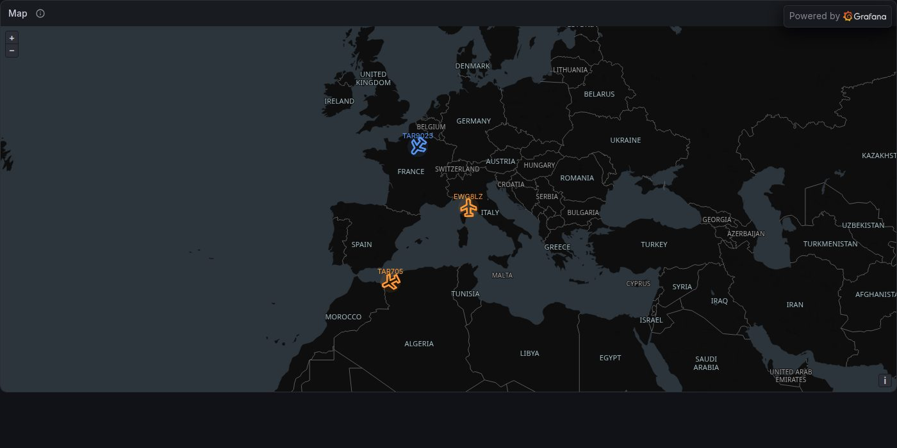
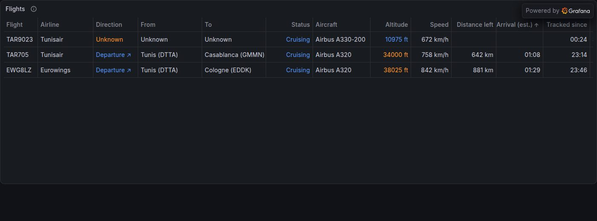
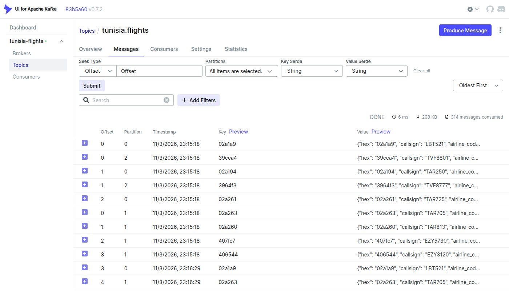
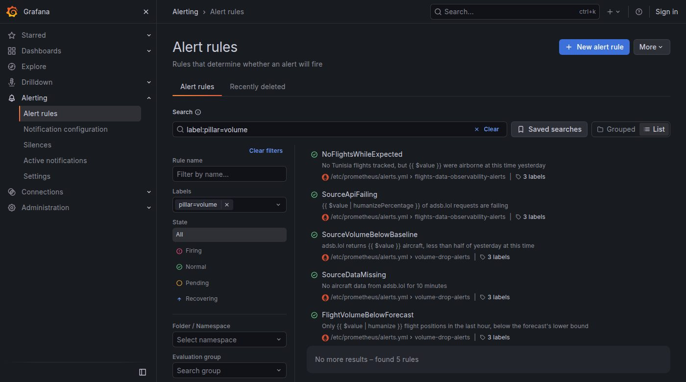

<!-- Exported from the Grafana notebook "Detect data volume drops · Tunisia flights" by scripts/export_notebook_markdown.py -->

# Detect data volume drops

A drop in data volume leaves gaps in the information that decisions are based on, and it rarely
throws an error. This notebook shows how to catch volume drops with Grafana, Prometheus and
Grafana Machine Learning on a live pipeline that tracks every flight to and from Tunisia:

> adsb.lol (live ADS-B) → producer → Kafka `tunisia.flights` → quality checker → Prometheus → Grafana

How you detect a drop depends on **how often data arrives**:

1. **High ingestion frequency:** a continuous stream, compared with a baseline.
2. **Low ingestion frequency:** batches, compared with a one-step-ahead forecast.
3. **Better forecasts:** seasonal baselines, PromQL trend functions and Grafana Machine Learning.

Then two forecasting use cases that answer real questions:

4. **Arrivals at Tunisian airports:** how many planes land in the next hours, and tomorrow.
5. **Monitoring capacity:** when the stack will outgrow its Grafana Cloud plan.
6. **Arrival delays:** official schedules joined with the landings the pipeline detects.

### The data

The live dashboard tracks every flight to and from Tunisia, and each position is one record on the
Kafka topic `tunisia.flights`. These record counts are what we monitor below.



*Flights to and from Tunisia, live from the Tunisia Flights dashboard*



*The same flights as a table: route, status and estimated arrival*



*Raw records on the Kafka topic tunisia.flights (Kafka UI)*

## 1. High ingestion frequency: baseline comparison

Our source is a continuous stream: every minute, adsb.lol returns about 1,000 aircraft over
Tunisia and Europe. The simplest robust baseline is the same moment **yesterday**: it absorbs the
daily rhythm of air traffic for free.

**Panel: Aircraft reported by adsb.lol: today vs. yesterday** (timeseries)

> The alert fires when 'today' stays below the dashed line for 15 minutes. The dashed line is the same data shifted by 24 hours (offset 1d), so it only appears once the pipeline has run for a day.

```promql
# today
sum(adsb_aircraft_in_areas)
# alert threshold (50% of yesterday)
0.5 * sum(adsb_aircraft_in_areas offset 1d)
```

Two alert rules cover this case (in `prometheus/alerts.yml`, group `volume-drop-alerts`):

- **Volume drop:** less than half of yesterday's volume for 15 minutes.
- **Missing data:** no data at all for 10 minutes, the worst case of a drop.

```yaml
- alert: SourceVolumeBelowBaseline
  expr: sum(adsb_aircraft_in_areas) < 0.5 * sum(adsb_aircraft_in_areas offset 1d)
  for: 15m
  labels: { pillar: volume, team: data-engineering, severity: warning }

- alert: SourceDataMissing
  expr: absent_over_time(adsb_aircraft_in_areas[10m])
  labels: { pillar: volume, team: data-engineering, severity: page }
```

**Tune before you trust it.** Open the rule in **Alerting → Alert rules → Edit** and use
**Preview** to see how often it would have fired over the last days. Raise or lower the `0.5`
factor until it only fires on real incidents.

## 2. Low ingestion frequency: one-step-ahead forecast

For batch data, a fixed threshold is too blunt and a rate is meaningless between batches. Instead,
forecast the **next hour's record count** and check whether the actual count lands inside the
prediction interval. We treat the **number of valid flight positions per hour** as our batch.

| Forecast setting | Prometheus implementation |
|---|---|
| Runs on a schedule | Recording rules evaluated by the ruler every 5 minutes |
| Training period: 72 hours, current hour excluded | Subquery `[72h:1h] offset 1h`: 72 hourly samples |
| Coverage probability: 90% | ± 1.645 standard deviations (normal approximation) |
| Points to predict: 1 | One band value per evaluation, compared with the current hour |

### Step 1: Schedule the analysis

The Prometheus ruler evaluates the group `volume-forecast` in `prometheus/rules.yml` every 5 minutes. On Grafana
Cloud, the same file is uploaded to the stack with `mimirtool rules load`.

```yaml
- name: volume-forecast
  interval: 5m
  rules:
    - record: flights:positions:count1h
      expr: sum(increase(flights_valid_positions_total[1h]))
```

### Step 2: Forecast

The forecast is the mean of the previous 72 hourly counts, with a band of ± 1.645 standard
deviations around it: about **90%** of normal hours should fall inside it. The rules query the raw
counter rather than the recorded hourly series: recording rules only compute going forward, while
the raw counter already has the history.

```yaml
- record: flights:positions:lower_bound
  expr: |
    clamp_min(
      avg_over_time(sum(increase(flights_valid_positions_total[1h]))[72h:1h] offset 1h)
      - 1.645 * stddev_over_time(sum(increase(flights_valid_positions_total[1h]))[72h:1h] offset 1h), 0)
- record: flights:positions:upper_bound
  expr: |
    avg_over_time(sum(increase(flights_valid_positions_total[1h]))[72h:1h] offset 1h)
    + 1.645 * stddev_over_time(sum(increase(flights_valid_positions_total[1h]))[72h:1h] offset 1h)
```

**Panel: Hourly flight positions and the 90% prediction band** (timeseries)

> A point of 'actual' below the shaded band is a volume drop. One training sample per clock hour (UTC): the forecast line needs 1 full past hour, the band needs 2.

```promql
# actual (last hour)
flights:positions:count1h
# upper bound
flights:positions:upper_bound
# lower bound
flights:positions:lower_bound
# forecast
flights:positions:forecast_mean
```

### Step 3: Retrieve the current records

Records received in the last hour:

```promql
sum(increase(flights_valid_positions_total[1h]))
```

**Panel: Flight positions received in the last hour** (stat)

```promql
# last hour
flights:positions:count1h
# lower bound
flights:positions:lower_bound
```

### Step 4: Compare prediction and current volume, then alert

A single alert rule (in `prometheus/alerts.yml`) compares the current count with the forecast's lower bound.

The last line is a lesson from real data: without it, the rule fires every night, because the flat
forecast still expects daytime traffic. It only alerts when the same hour yesterday had real traffic.
Part 3 shows forecasts that understand the daily cycle and don't need this guard.

```yaml
- alert: FlightVolumeBelowForecast
  expr: |
    flights:positions:count1h < flights:positions:lower_bound
    and on() flights:positions:count1h offset 1d > 100
  for: 10m
  labels: { pillar: volume, team: data-engineering, severity: warning }
  annotations:
    summary: "Only {{ $value | humanize }} flight positions in the last hour, below the forecast's lower bound"
```

**Panel: Headroom above the lower bound** (timeseries)

> Below zero (red area) the current hour is under the forecast band. The forecast samples one point per clock hour (UTC) and skips the current hour, so it starts at the second full clock hour after data collection begins; the band needs one more hour.

```promql
# actual − lower bound
flights:positions:count1h - flights:positions:lower_bound
```

### Step 5: Observe the low data volume alerts

Firing volume alerts are listed below and in **Alerting → Alert rules** (filter `pillar=volume`).
To get notified, add a contact point (email, Slack) and a notification policy matching
`team=data-engineering`.



*Alerting → Alert rules filtered on pillar=volume: the five volume rules from this notebook*

**Panel: Volume alerts** (state-timeline)

```promql
# {{alertname}}
max by (alertname) (ALERTS{pillar="volume", alertstate="firing"})
# all volume checks
vector(0) unless on() count(ALERTS{pillar="volume", alertstate="firing"})
```

## 3. Better forecasts with Grafana

Air traffic has a strong daily cycle: almost nothing at 03:00, peaks in the morning. A flat
72-hour average is too wide during the day and misfires at night. For seasonal data, a model needs
to learn the cycle, ideally from **two weeks or more** of history. Grafana offers three levels:

| Approach | Learns the daily cycle | Where it runs | Needs |
|---|---|---|---|
| **A. Seasonal baseline** (PromQL) | Yes, same hour on the last 7 days | Any Prometheus | 2+ days of data |
| **B. Trend extrapolation** (`predict_linear`) | No, short-term trend only | Any Prometheus | A few hours |
| **C. Grafana Machine Learning** forecast | Yes, daily and weekly, automatically | Grafana Cloud | 2+ days (daily), 2+ weeks (weekly) |

### A. Seasonal baseline: same hour on previous days

The forecast for this hour is the mean of the **same hour on each of the last 7 days**, with a
± 1.645 sd band. At night the expected value is close to zero, so the band no longer misfires. The
rules are in the group `volume-forecast-seasonal` (`prometheus/rules.yml`). The `or` with a `day` label keeps
the result valid while fewer than 7 days of history exist.

```yaml
- record: flights:positions:seasonal_mean
  expr: |
    avg without (day) (
        label_replace(sum(increase(flights_valid_positions_total[1h] offset 1d)), "day", "1", "", "")
     or label_replace(sum(increase(flights_valid_positions_total[1h] offset 2d)), "day", "2", "", "")
     # … up to offset 7d
    )
```

**Panel: Seasonal baseline: same hour on the last 7 days** (timeseries)

> Appears after 1 day of history; the band needs at least 2 days.

```promql
# actual (last hour)
flights:positions:count1h
# upper bound
flights:positions:seasonal_upper
# lower bound
flights:positions:seasonal_lower
# seasonal forecast
flights:positions:seasonal_mean
```

### B. Short-term trend with `predict_linear`

PromQL's `predict_linear(v[range], seconds)` fits a straight line through recent samples and
extrapolates it. Here: where will the hourly count be **one hour from now**, based on the last
3 hours? It reacts quickly to a sudden decline but knows nothing about the daily cycle, so it is
best used together with A or C, not alone.

```promql
predict_linear(flights:positions:count1h[3h], 3600)
```

**Panel: Linear trend: expected hourly count in 1 hour** (timeseries)

```promql
# actual (last hour)
flights:positions:count1h
# predicted in 1 h
clamp_min(predict_linear(flights:positions:count1h[3h], 3600), 0)
```

### C. Grafana Machine Learning: metric forecast

**Grafana Cloud Machine Learning** trains a forecasting model on the history of a query, detects
daily and weekly seasonality automatically, and writes the prediction and a 95% interval back as
metrics in the `grafanacloud-ml-metrics` data source:

- `tunisia_flight_positions:predicted{ml_forecast="yhat"}`: the forecast
- `tunisia_flight_positions:predicted{ml_forecast="yhat_lower"}` and `…="yhat_upper"}`: the interval
- `tunisia_flight_positions:actual`: the real values, for comparison

The forecast job and its alert are managed as code in `terraform/main.tf`. The model retrains every
24 hours, and its seasonality improves as history grows. The model needs at least **100 data
points** before its first training succeeds (about 3.5 hours at one point every 2 minutes).
*Available on Grafana Cloud only.*

```hcl
resource "grafana_machine_learning_job" "flight_positions_forecast" {
  name            = "Tunisia flight positions per hour"
  metric          = "tunisia_flight_positions"
  datasource_type = "prometheus"
  datasource_uid  = var.prometheus_uid
  query_params    = { expr = "flights:positions:count1h" }
  interval        = 120  # seconds between training points
}

resource "grafana_machine_learning_alert" "flight_positions_drop" {
  job_id            = grafana_machine_learning_job.flight_positions_forecast.id
  title             = "Flight positions below ML forecast"
  anomaly_condition = "low"
  for               = "15m"
  labels            = { pillar = "volume", team = "data-engineering" }
}
```

**Panel: Grafana ML forecast with 95% interval** (timeseries, data source `grafanacloud-ml-metrics`)

> Grafana Cloud Machine Learning. Points of 'actual' outside the band are anomalies.

```promql
# actual
tunisia_flight_positions:actual
# upper bound
tunisia_flight_positions:predicted{ml_forecast="yhat_upper"}
# lower bound
tunisia_flight_positions:predicted{ml_forecast="yhat_lower"}
# ML forecast
tunisia_flight_positions:predicted{ml_forecast="yhat"}
```

The ML alert fires when actual values stay **below** the forecast interval for 15 minutes. The
equivalent PromQL condition, if you prefer a regular alert rule on the `grafanacloud-ml-metrics`
data source:

```promql
tunisia_flight_positions:actual
  < bool ignoring(ml_forecast)
tunisia_flight_positions:predicted{ml_forecast="yhat_lower"}
```

## 4. Use case: forecast arrivals at Tunisian airports

Forecasting is most useful when it answers an operational question. Ground handling, border control,
taxis and people waiting at the airport all ask the same one: **how many planes will land at Tunis,
Enfidha, Monastir or Djerba in the coming hours?** The pipeline answers it on two horizons:

| Horizon | Method | Source |
|---|---|---|
| Next 30 min, 1 h, 2 h | Count tracked flights whose estimated arrival falls in the window | Live positions: distance left ÷ ground speed |
| Next 24 h and beyond | Grafana Machine Learning forecast of landings per hour, per airport | History of detected landings; learns the daily and weekly schedule |

**Panel: Expected arrivals at Tunisian airports** (bargauge)

> Flights currently tracked toward each Tunisian airport, by estimated arrival time. Airports with no traffic are hidden.

```promql
# {{airport}} · 30 min
max by (airport) (airport_expected_arrivals{within="30m"})
# {{airport}} · 1 h
max by (airport) (airport_expected_arrivals{within="1h"})
# {{airport}} · 2 h
max by (airport) (airport_expected_arrivals{within="2h"})
```

**Counting landings.** ADS-B has no "landed" message, so the quality checker detects it: a flight to a
Tunisian airport counts as **landed** when it is below 4,000 ft within 25 km of the airport. Receiver
coverage near the ground in Tunisia is thin, so a flight that **disappears within 80 km** of its
destination also counts (`detection="lost_near_destination"`). Take-offs are counted the same way near
the departure airport. These counts are the training data for the forecast.

```yaml
- record: airport:arrivals:count1h
  expr: sum by (airport) (increase(airport_arrivals_total[1h]))
- record: airport:departures:count1h
  expr: sum by (airport) (increase(airport_departures_total[1h]))
```

**Panel: Landings and take-offs per hour** (timeseries)

> Rolling 1-hour counts of detected landings and take-offs.

```promql
# landings (all Tunisian airports)
sum(airport:arrivals:count1h)
# take-offs (all Tunisian airports)
sum(airport:departures:count1h)
# landings · {{airport}}
airport:arrivals:count1h > 0
```

```hcl
resource "grafana_machine_learning_job" "airport_arrivals_forecast" {
  name            = "Arrivals per Tunisian airport per hour"
  metric          = "tunisia_airport_arrivals"
  datasource_type = "prometheus"
  datasource_uid  = var.prometheus_uid
  query_params    = { expr = "sum by (airport) (increase(airport_arrivals_total[1h]))" }
  interval        = 300
  training_window = 2592000 # 30 days
}
```

**Panel: Grafana ML forecast: landings per hour, per airport** (timeseries, data source `grafanacloud-ml-metrics`)

> Grafana Cloud Machine Learning. One model per airport; the daily schedule needs 2+ days of history, the weekly one 2+ weeks.

```promql
# forecast · {{airport}}
tunisia_airport_arrivals:predicted{ml_forecast="yhat"}
# actual · {{airport}}
tunisia_airport_arrivals:actual
```

## 5. Use case: forecast monitoring capacity

Forecasting also protects the observability stack itself. Grafana Cloud bills by **active series**,
and the free tier allows **10,000**. Every new flight creates new series (its position, altitude,
speed…), so the count grows with traffic. Will we hit the limit next week? `predict_linear` projects the
last 6 hours 7 days ahead, and an alert fires when the projection passes 90% of the limit.

`count({__name__=~".+"})` over the pipeline's series matches Grafana Cloud's own billing metric
(`grafanacloud_instance_active_series`: 387 vs. 388 when this was measured).

```yaml
- record: monitoring:active_series
  expr: count({__name__=~".+"})
- record: monitoring:active_series:predicted_7d
  expr: predict_linear(monitoring:active_series[6h], 7 * 86400)
- record: monitoring:active_series:days_to_limit
  expr: |
    (scalar(monitoring:active_series:limit) - monitoring:active_series)
    / (deriv(monitoring:active_series[6h]) * 86400) > 0

- alert: ActiveSeriesLimitWithin7Days
  expr: monitoring:active_series:predicted_7d > 0.9 * scalar(monitoring:active_series:limit)
  for: 1h
  labels: { pillar: capacity, team: data-engineering, severity: warning }
```

**Panel: Active series: now, projected in 7 days, and the free-tier limit** (timeseries)

```promql
# active series
monitoring:active_series
# projected in 7 days
monitoring:active_series:predicted_7d
# free-tier limit
monitoring:active_series:limit
```

**Panel: Days until the limit at the current growth rate** (stat)

> 999 means the series count is not growing.

```promql
# days
min(monitoring:active_series:days_to_limit) or vector(999)
```

## 6. Use case: arrival delays

ADS-B tells us **when** a plane lands, but not when it **should** have landed. Free schedule data
comes from **AeroDataBox** (free plan, 400 units a month): one call returns 12 hours of scheduled
arrivals for an airport, every airline. For Tunisian airports it only has scheduled times, so the
pipeline joins them with its own landing detection:

> **delay = landing detected from ADS-B − scheduled arrival (AeroDataBox)**

| Step | Where |
|---|---|
| Fetch scheduled arrivals for Tunis, Enfidha and Monastir twice a day (360 of 400 units a month) | `schedules` service → Kafka `tunisia.schedules` |
| Match a landing to its schedule: AeroDataBox `TU 719` + airline ICAO `TAR` = ADS-B callsign `TAR719` | quality checker |
| Delay histogram per airport and airline; on time = less than 15 minutes late | `airport_arrival_delay_minutes` |
| Scheduled arrivals never detected landing = **completeness** of our own tracking | `airport_schedule_matches_total{result="missed"}` |

Accuracy is about ±5–10 minutes (positions every minute, landing detected near the ground).

```yaml
- record: airport:arrival_on_time:ratio24h
  expr: |
    sum by (airport) (increase(airport_arrival_delay_minutes_bucket{le="15.0"}[24h]))
    / sum by (airport) (increase(airport_arrival_delay_minutes_count[24h]))

- alert: ArrivalDelaysHigh
  expr: |
    airport:arrival_delay:avg3h > 45
    and sum by (airport) (increase(airport_arrival_delay_minutes_count[3h])) >= 5
  for: 30m
```

**Panel: Average arrival delay per airport (rolling 3 h)** (timeseries)

> Minutes late on average over the last 3 hours. Starts with the first matched landings.

```promql
# {{airport}}
airport:arrival_delay:avg3h
```

**Panel: On-time rate by airline (24 h)** (bargauge)

```promql
# {{airline}}
sort(airline:arrival_on_time:ratio24h)
```

**Panel: Scheduled arrivals detected by the pipeline (24 h)** (bargauge)

> Low values mean receiver coverage gaps, or callsigns that differ from the flight number.

```promql
# {{airport}}
airport:schedule_match:ratio24h
```

## Summary

| Question | Method | Rule / job |
|---|---|---|
| Is the stream arriving as usual? | Same time yesterday, plus a missing-data check | `SourceVolumeBelowBaseline`, `SourceDataMissing` |
| Is this hour's batch complete? | One-step-ahead forecast with a 90% prediction band | `FlightVolumeBelowForecast` |
| Normal for this hour of the day? | Seasonal baseline, or a Grafana Machine Learning forecast | `flights:positions:seasonal_*`, ML alert |
| How many planes land at each airport soon? | Estimated arrivals (next 2 h), ML forecast (next days) | `airport_expected_arrivals`, `tunisia_airport_arrivals` |
| Will monitoring outgrow its plan? | `predict_linear` on active series | `ActiveSeriesLimitWithin7Days` |
| Are flights landing on time? | Detected landing − scheduled arrival (AeroDataBox) | `ArrivalDelaysHigh`, `LandingDetectionIncomplete` |

Start with volume: it is the cheapest check and catches the most incidents. Then move from
simple baselines to seasonal and ML forecasts as history accumulates, and point forecasts at the
questions your users actually ask.
